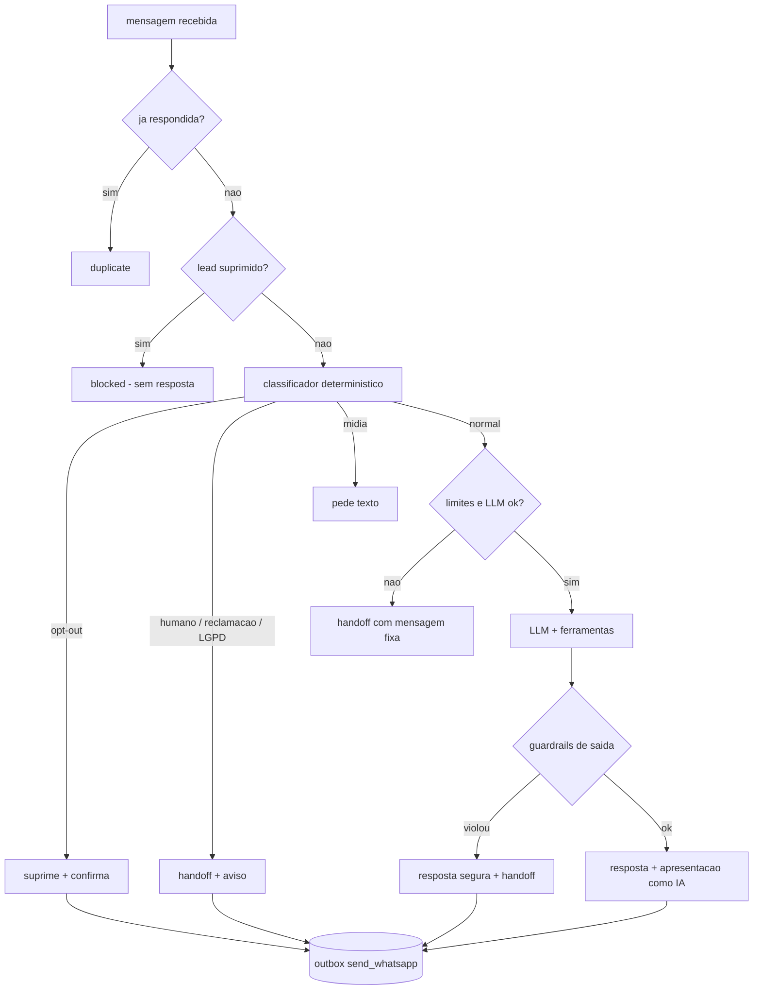

# Agente comercial de IA (Fase 06)

O agente responde mensagens recebidas, tira dúvidas sobre os planos e **passa para um humano** quando
precisa. Endpoint: `POST /v1/agent/respond` (idempotente por `external_id`, ex.: `wamid` do WhatsApp).



## Camadas de defesa
| Risco | Defesa | Onde |
|---|---|---|
| Opt-out / LGPD / reclamação tratados por IA | Classificador por regras **antes** do LLM; IA nunca decide suprimir | `agent_guard.classify_intent` |
| Preço inventado | Preços só via ferramenta `get_plans` (banco); qualquer `R$` fora do catálogo descarta a resposta | `check_reply` |
| Prompt injection | Mensagem do cliente delimitada e **sanitizada** (não consegue fechar a tag), tratada como dado; ferramentas agem só no lead do contexto; enums validados | `sanitize_input`, `agent_tools` |
| Vazamento do prompt | Marcador secreto (canary) no prompt; se aparecer na resposta, bloqueia | `canary_for` |
| Links / golpe | URLs só de domínios em `ALLOWED_REPLY_HOSTS` | `check_reply` |
| Dados sensíveis | Resposta que peça CPF/cartão/senha é bloqueada | `check_reply` |
| Dados pessoais no LLM | O modelo vê só categorias do lead (segmento, região, perfil) — nunca nome, endereço ou telefone | `agent.handle_inbound` |
| Custo descontrolado | Teto de turnos e tokens por conversa, teto diário global, tokens e custo registrados | `agent_max_*`, `api_usage` |
| LLM fora do ar | Retry/backoff; depois, handoff com mensagem fixa (o cliente nunca fica sem resposta) | `fallback` |
| Transparência | 1ª mensagem sempre se apresenta como assistente virtual (garantido em código, não só no prompt) | `finalize_reply` |

## Provedor e quotas
O provedor é selecionado por `LLM_PROVIDER=anthropic` ou `LLM_PROVIDER=gemini`. Para Gemini, use uma chave da
Gemini Developer API criada no Google AI Studio em `GEMINI_API_KEY`; a assinatura Gemini Pro do app de consumidor
não concede automaticamente chave nem quota para a API. Os limites ativos por projeto/modelo ficam em
[AI Studio > Rate limits](https://aistudio.google.com/rate-limit).

`LLM_DAILY_CALL_LIMIT`, `LLM_RPM_LIMIT` e `LLM_INPUT_TPM_LIMIT` limitam chamadas, requisições/minuto e entrada/minuto.
O valor informado para este projeto é 250 chamadas/dia, 10 RPM e 2.500 TPM de entrada. A estimativa local usa
1 token para cada 2 bytes UTF-8 serializados: é uma aproximação com margem, não o tokenizer oficial do provedor.
A quota efetiva do provedor continua sendo a autoridade final. `Retry-After` é respeitado em respostas 429.
Defina um limite como `0` para desativá-lo.

Se usar Anthropic, selecione `LLM_PROVIDER=anthropic` e preencha `ANTHROPIC_API_KEY`. As cotas Anthropic dependem
do nível e da conta no Console; Claude Free/Pro não é uma chave de API.

## Memória
Isolada por lead: histórico = últimas `AGENT_HISTORY_MESSAGES` interações **daquele lead** + dados coletados
(`conversations.qualification`). Não há resumo automático por LLM nesta versão (janela deslizante apenas).

## Ferramentas
`get_plans` · `record_qualification` · `request_handoff` · `create_proposal_request` (cria **rascunho** de
oportunidade; nada é enviado ao cliente).

## Catálogo
Os 3 planos nascem **sem preço**: o agente diz "sob consulta" até você definir:
`PATCH /v1/plans/{id}` com `{"price_cents": 150000, "description": "...", "features": ["..."]}`.

## Como testar
```bash
SERVICE_API_KEY=... python scripts/chat_cli.py --phone "(11) 91234-5678"   # conversa no terminal
SERVICE_API_KEY=... python api/evals/run_evals.py                            # evals com o LLM real
```
Rode os evals a cada mudança de prompt ou de modelo. Adicione casos novos em `api/evals/agent_cases.json`.

## Fora desta parte
Envio efetivo no WhatsApp, templates aprovados e webhook da Meta com HMAC (Parte 4). Até lá as respostas
ficam no outbox (`send_whatsapp`).
