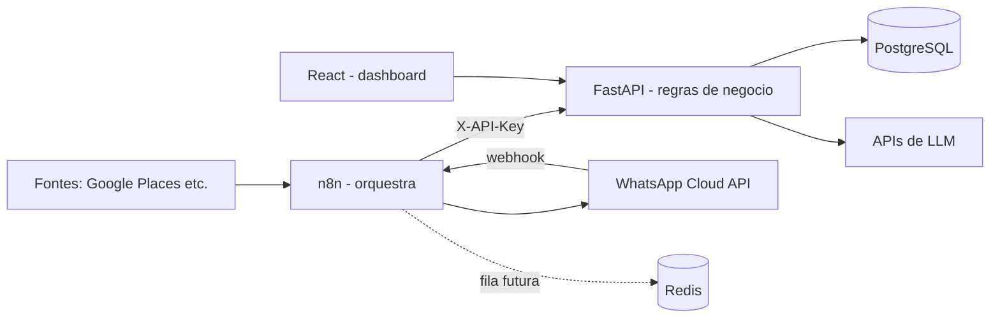

# Arquitetura

## Responsabilidades
| Camada | Faz | Não faz |
|---|---|---|
| **n8n** | agenda, dispara, chama APIs, aplica retry, notifica | regra de negócio, estado do funil |
| **FastAPI** | validação, scoring, estado do lead, política de contato, auditoria | agendamento |
| **PostgreSQL** | fonte única da verdade, idempotência (UNIQUE), outbox | lógica de fluxo |

## Padrões de resiliência já presentes
- `interactions.external_id` UNIQUE → webhooks duplicados viram 409 inofensivo.
- `outbox_events` com `idempotency_key`, `claim` (SKIP LOCKED), backoff e dead-letter.
- `payments.idempotency_key` UNIQUE → cobrança nunca duplica.
- Estado do lead com transições validadas e auditadas.
- `request_id` em todos os logs e na resposta (`X-Request-ID`).
