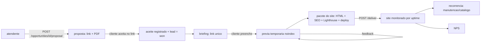

# Fechamento, entrega e pós-venda (Fases 09 a 11)

## Fluxo
1. **Proposta**: `POST /v1/opportunities/{id}/proposal` gera token, validade (`PROPOSAL_VALIDITY_DAYS`) e links
   (`/public/proposals/{token}` e `.pdf`). `send-proposal` envia o link pelo WhatsApp (janela de 24 h).
2. **Aceite**: o cliente clica; fica registrado com data/hora (idempotente), o lead vira `won`, a equipe é avisada e o
   **briefing** é criado e enviado (ou o link vai para a equipe, se a janela estiver fechada).
3. **Briefing → prévia**: o formulário público é sanitizado e cifrado em repouso. `POST .../preview` gera uma prévia
   com `noindex`, CSP restrita e **expiração** (`PREVIEW_TTL_DAYS`; o WF03 apaga o conteúdo ao expirar). O cliente envia feedback no link.
4. **Pacote final**: `GET .../site-package?domain=...` baixa um ZIP com `index.html` (SEO, JSON-LD), `robots.txt`,
   `sitemap.xml`, `lighthouserc.json` + workflow, `README_DEPLOY.md` (Cloudflare Pages/Vercel, domínio) e `OFFBOARDING.md`.
5. **Entrega**: `POST .../deliver {url}` marca a entrega, cria o monitor de uptime e pede o NPS.
6. **Pós-venda**: mensagem de cliente com lead `won` abre **chamado** (`/v1/tickets`) e avisa a equipe.
7. **Recorrência**: `POST .../subscriptions` (manutenção, catálogo digital, agendamento). O WF11 gera as cobranças do mês
   (idempotente), marca **atraso** (alertas aos 1, 5 e 15 dias) e sugere **upsell** 30 dias após a entrega.
8. **Uptime**: WF10 verifica os sites a cada 5 min (com proteção SSRF); alerta só após **2 falhas seguidas**.

## Cobrança
`POST .../charge` cria a cobrança (chave de idempotência por oportunidade) com provedor `manual`; marque como paga com
`mark-paid`. Há também `POST /v1/payments/webhook/{provider}` (HMAC, idempotente por `provider_ref`) pronto para um
provedor (Pix/cartão) — **a integração com um provedor específico não está feita**: depende de qual você escolher.

## Backups
O serviço `backup` faz dump diário (banco da aplicação **e** do n8n) em `./backups`, com retenção
(`BACKUP_RETENTION_DAYS`). **Teste a restauração**: `./scripts/restore_test.sh`. Copie `./backups` para fora do servidor.

## Encerramento (offboarding)
Checklist no pacote do site. Exclusão de dados a pedido: `POST /v1/privacy/erase`.
