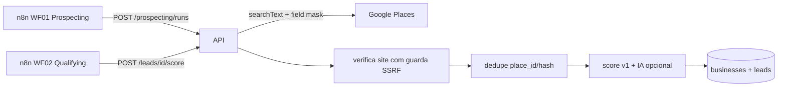

# Prospecção e scoring (Fases 03 e 04)

## Fluxo

## Contrato para o n8n
1. **WF01** (agendado, ex.: 1x/dia): `POST /v1/prospecting/runs` → se `status=partial`,
   `POST /runs/{id}/continue`. `status=quota` → pare até o dia seguinte; `failed` → alerta.
2. **WF02**: leads `new` com tier B/C ou antigos → `POST /v1/prospecting/leads/{id}/score`.
3. **Antes de contatar:** `GET /v1/prospecting/businesses/{id}/live` (telefone/nome atuais) e depois
   `GET /v1/compliance/can-contact`. Se `allowed=false`, não envie.
4. **Retenção:** agende `POST /v1/prospecting/purge-expired` diariamente (no-op em `strict`).

## Resiliência e custo
- Retry com backoff exponencial + jitter em 429/5xx/rede; 4xx não repete.
- Quota diária **atômica** (`PLACES_DAILY_CALL_LIMIT`); o Google não tem teto de gasto, só alertas.
- Field mask mínimo: telefone e site entram em faixa de cobrança mais alta; ajuste conforme o preço vigente.
- Paginação retomável (`prospecting_runs.next_page_token`); o token exige a mesma query.
- Verificação de site: timeout, no máximo 3 redirects, bloqueia IP privado/loopback/link-local,
  não baixa o corpo. 403/429 contam como "site existe" (proteção anti-bot).

## Regras do score v1
| Regra | Pontos |
|---|---|
| Sem site / só rede social / site fora do ar / não verificado | +35 / +30 / +25 / +10 |
| Telefone válido / celular | +15 / +10 |
| 100+ / 30+ / 10+ avaliações | +15 / +10 / +5 |
| Nota ≥ 4,3 / 4,0–4,2 / < 3,5 | +10 / +5 / −5 |
| Segmento do piloto / fora | +10 / −10 |
| Ajuste da IA (opcional) | −10 a +10 |
