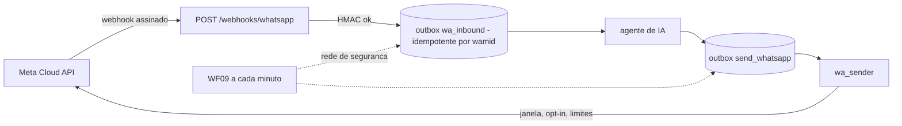

# WhatsApp (Fase 07)

## Arquitetura

O webhook chega **direto na API** (não no n8n) porque a assinatura HMAC vale para o **corpo bruto**.
A mensagem é gravada de forma durável **antes** de qualquer processamento e a Meta recebe `200` rápido;
o processamento roda em seguida e o **WF09** reprocessa o que ficar para trás.

## Configuração (Meta for Developers)
1. Crie um app do tipo *Business* e adicione o produto **WhatsApp**; anote o **ID do número de telefone**.
2. Gere um **token permanente** (usuário do sistema no Business Manager) → `WHATSAPP_ACCESS_TOKEN`.
3. Em *Configurações do app → Básico*, copie a **Chave secreta do app** → `WHATSAPP_APP_SECRET`.
4. Defina `WHATSAPP_VERIFY_TOKEN` (qualquer segredo seu), `WHATSAPP_PHONE_NUMBER_ID`, `WHATSAPP_ENABLED=true`.
5. Exponha a API com HTTPS (domínio ou túnel) e cadastre o webhook:
   `https://SEU-DOMINIO/webhooks/whatsapp` + o verify token; assine o campo **messages**.
6. Confira em `GET /v1/whatsapp/status` (ou na tela *Sistema* do CRM) se está tudo `ok`.

## Regras que o código aplica
| Regra | Onde |
|---|---|
| Assinatura `X-Hub-Signature-256` obrigatória (corpo bruto, tempo constante) | `routes/whatsapp.py` |
| Handshake `hub.challenge` só com o token correto | idem |
| Reentrega da Meta não duplica resposta (`wamid` único) | `wa_inbound`, `outbox` |
| Texto livre só dentro da **janela de 24 h** após a última mensagem do cliente | `wa_sender` |
| Fora da janela só **template aprovado** e só com **opt-in** registrado | `wa_sender`, `followups` |
| Suprimido/revogado nunca recebe — conferido **no momento do envio** (exceto a confirmação do próprio opt-out) | `wa_sender` |
| Teto diário de templates (`WHATSAPP_MAX_TEMPLATES_PER_DAY`) | `wa_sender` |
| Erros da Meta classificados: repetir, token inválido (alerta), fora da janela, permanente | `whatsapp.classify_error` |
| Recibos `sent/delivered/read/failed` atualizam a conversa; falha gera aviso | `wa_inbound.apply_statuses` |
| Sem retry cego de 5xx no envio (a API não tem chave de idempotência): a fila reenvia com checagem de "já enviado" | `wa_sender` |

## Templates sugeridos (envie para aprovação na Meta)
Todos terminam com a instrução de saída. Categoria *Marketing*, idioma `pt_BR`, **sem variáveis** (evita dado pessoal no template).
- `followup_1`: "Olá! Aqui é da {{agência}}. Passando para saber se ainda tem interesse em um site para o seu negócio. Se preferir não receber mais mensagens, responda PARE."
- `followup_2`: "Olá, tudo bem? Posso te mostrar como ficaria um site para o seu negócio, sem compromisso. Para não receber mais mensagens, responda PARE."

> Os nomes precisam ser exatamente `followup_1` e `followup_2` (o WF06 usa `followup_{tentativa}`).

## Opt-in
Mensagem recebida **não** vale como opt-in para marketing. Registre o consentimento explicitamente
(`POST /v1/consents`, formulário, anúncio click-to-WhatsApp). Sem opt-in, não há follow-up por template.

## Limites desta versão
Não testado contra a API real da Meta (apenas com dublês). Mídia recebida (áudio/imagem) recebe pedido de texto;
não há envio de mídia nem botões interativos. O tier de mensagens do seu número define o teto real.
